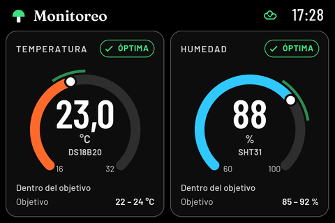

# pi-sensor-station

Lightweight Python sensor station for Raspberry Pi Zero W with SHT31 and DS18B20 readings, a 3.5-inch LCD display, and HTTP data delivery to a remote API.

One Python service reads both sensors, draws directly to the LCD framebuffer with Pillow, and sends JSON to [go-sensor-data-collector](https://github.com/yayodelmal/go-sensor-data-collector) on another server. A desktop environment is unnecessary. Touch input is not implemented.



The display follows the supplied [HTML reference](design/monitoreo-reference.html): temperature and humidity dials, target bands, Spanish status labels, clock, sensor fallback and delivery status. High contrast is the default palette, centralized in `src/pi_sensor_station/colores.py`. It runs entirely in Pillow; the HTML is a design artifact. Fonts and their OFL licenses ship with the package.

## Wiring

Target: Pi Zero W, Raspberry Pi OS Lite, 3.5-inch RPi LCD (A) V3, ILI9486 display.

| Sensor signal | BCM GPIO | Physical pin |
| --- | --- | --- |
| SHT31 SDA | 2 | 3 |
| SHT31 SCL | 3 | 5 |
| DS18B20 DATA | 4 | 7 |
| Sensor power | 3.3 V | 1 or 17 |
| Sensor ground | GND | 6 or another ground pin |

Use externally powered, three-wire mode for the DS18B20 and a 4.7 kΩ pull-up between DATA and 3.3 V unless its module already includes one. Verify the module pinout rather than relying on cable colors. I²C pull-ups must connect to 3.3 V; confirm your SHT31 breakout supports that supply.

The LCD (A) lists physical pins 3, 5 and 7 as unused. A GPIO splitter may be needed when the screen covers the header. Power off before changing wiring.

References: [LCD pinout](https://www.waveshare.com/wiki/3.5inch_RPi_LCD_%28A%29), [SHT3x datasheet](https://sensirion.com/media/documents/213E6A3B/63A5A569/Datasheet_SHT3x_DIS.pdf), [DS18B20 datasheet](https://www.analog.com/media/en/technical-documentation/data-sheets/ds18b20.pdf).

## Enable interfaces

Back up `/boot/firmware/config.txt`. Enable these settings under `[all]`, keeping only one display overlay:

```ini
dtparam=i2c_arm=on
dtparam=spi=on
dtoverlay=w1-gpio,gpiopin=4
dtoverlay=fbtft,spi0-0,ili9486,regwidth=16,reset_pin=25,dc_pin=24,speed=16000000,rotate=90,bgr=1
```

This LCD configuration was tested on this project's Pi. Other revisions may differ. Do not force `width=480,height=320` with rotation 0; that distorted the image on this unit. Reboot after changing configuration, then check:

```bash
ls /dev/i2c-1
ls /sys/bus/w1/devices/28-*/w1_slave
cat /sys/class/graphics/fb1/{name,virtual_size,bits_per_pixel,stride}
```

Expected framebuffer values: `fb_ili9486`, `480,320`, `16`, `960`. Set `FRAMEBUFFER` if numbering differs.

## Install

These paths assume the Pi user is `zero`:

```bash
sudo apt-get update
sudo apt-get install -y git python3-venv python3-pil
git clone https://github.com/yayodelmal/pi-sensor-station.git
cd pi-sensor-station
python3 -m venv --system-site-packages .venv
.venv/bin/python -m pip install -e .
cp .env.example .env
chmod 600 .env
```

The OS Pillow package avoids compilation on ARMv6. Edit `.env` to set the remote server's `API_URL` and optional `API_TOKEN`. Use HTTPS for tokens over untrusted networks. The collector must use `INGEST_MODE=http` or `both`.

## Run

The application reads environment variables, not `.env` directly. Load the file for an interactive shell:

```bash
set -a
. ./.env
set +a
.venv/bin/python -m pi_sensor_station --once
.venv/bin/python -m pi_sensor_station
```

A hardware-free smoke test that does not send fabricated data:

```bash
.venv/bin/python -m pi_sensor_station --simulate --no-display --no-send --once
```

`--simulate` replaces only sensor input. Add `--no-send` to prevent sending example measurements. `--no-display` disables the LCD. `--once` waits for the HTTP result and exits, with status 1 on sensor or delivery failure.

| Variable | Default | Purpose |
| --- | --- | --- |
| `API_URL` | Required unless `--no-send` | HTTP(S) base URL |
| `API_TOKEN` | Empty | Optional Bearer token |
| `READ_INTERVAL` | `5` | Acquisition interval, seconds |
| `SEND_INTERVAL` | `30` | Minimum HTTP batch interval, seconds |
| `HTTP_TIMEOUT` | `5` | Network operation timeout, seconds |
| `I2C_BUS` | `1` | Linux I²C bus |
| `SHT31_ADDRESS` | `0x44` | Sensor address; optionally `0x45` |
| `DS18B20_ID` | Empty | Discover exactly one device, or specify its `28-...` ID |
| `FRAMEBUFFER` | `/dev/fb1` | LCD device |
| `MONITOR_CONFIG` | Empty | Optional path to a monitor configuration JSON file |

## Display configuration and previews

Copy `config.example.json` to `config.json` and set `MONITOR_CONFIG=/home/zero/pi-sensor-station/config.json` in `.env` to customize the display. Restart the service after edits. Invalid configurations stop startup with a clear error.

Defaults mirror the reference: temperature target 22–24 °C on a 16–32 °C dial, humidity target 85–92% on a 60–100% dial. These are adjustable design defaults. `temperature_source` selects `ds18b20` or `sht31`. `temperature_fallback` allows the other sensor to supply the displayed temperature when the preferred sensor fails. Disable fallback when the probes measure different environments. This affects the display only: each HTTP endpoint always receives its own sensor's reading.

Boundaries are inclusive. Out-of-target values remain visible, with ALTA/BAJA badges, colored borders and deviation notes. Invalid or missing readings show an em dash; CRC failures show SIN DATO and absent devices show SIN SENSOR. The display never substitutes the last valid measurement for a failed acquisition.

The header starts at API pendiente and shows a success icon only after a successful HTTP batch. Delivery failures show API sin envío with elapsed minutes, covering network failures and HTTP rejections without assuming the cause is Wi-Fi. Disabled HTTP is labeled explicitly. Simulation adds a DEMO label on the physical display.

Swipe horizontally to switch between Inicio and Resumen. Touch calibration is set with `TOUCH_DEVICE`, `TOUCH_RAW_X`, `TOUCH_RAW_Y` and `TOUCH_ROTATION` in `.env`; short and vertical touches are ignored. The Resumen page keeps a 96-point, 24-hour history with one averaged sample every 15 minutes. It persists atomically at `HISTORY_PATH` (the systemd service uses `/var/lib/pi-sensor-station/history.json`).

Generate all 14 scenarios without sensors, a framebuffer or network requests:

```bash
.venv/bin/python -m pi_sensor_station.preview --output /tmp/station-previews
# Add --config config.json to preview custom targets.
```

Render the 26 deterministic Inicio/Resumen scenario PNGs with `--render-golden DIR`.

The output includes individual 480×320 PNGs and a contact sheet (`scenarios.png`). Dials are antialiased at 3× resolution and panel images are cached. Decorative animation is omitted. The main loop polls at up to 1 Hz, sensor reads follow `READ_INTERVAL`, and identical frames are not written again. The clock changes once per minute.

A one-off smoke test on the physical Pi Zero W rendered and wrote the first demo frame in 0.887 seconds, used 23.9 MiB peak RSS, and averaged 0.00055 seconds per unchanged update over ten calls. This measures the display path with simulated values, not the complete sensor and network service.

## Start at boot

Review the service's user and paths before installing:

```bash
sudo usermod -aG i2c,video zero
sudo cp deploy/pi-sensor-station.service /etc/systemd/system/
sudo systemctl daemon-reload
sudo systemctl enable --now pi-sensor-station
journalctl -u pi-sensor-station -f
```

systemd loads `.env` through `EnvironmentFile`. Use simple `KEY=value` entries without `export` or shell expansion. Stop the service before launching a second instance that writes to the LCD.

## Behavior and limitations

- Sensors are read independently and CRC failures are rejected. A failed sensor does not prevent sending valid readings from the other sensor.
- One background HTTP worker keeps network requests out of the acquisition loop. Only one batch can be in flight; batches never accumulate.
- Failed sends are logged. The next scheduled attempt sends fresh readings. There is **no persistent offline queue** or automatic replay of old readings.
- The LCD displays sensor availability and the last completed HTTP batch status. A display failure does not stop acquisition or HTTP; initialization failures disable the LCD until restart.
- Logs go to the journal. Tokens and response bodies are not logged.
- The collector currently timestamps data on insertion. Its numeric `binding:"required"` validation also rejects legitimate zero values. Correct that before relying on 0 °C or 0% readings. Offline replay would additionally need capture timestamps and deduplication support.

The original Pi display script used about 18.7 MiB peak RSS and six seconds per invocation. This version uses Pillow channel operations for RGB565 conversion, cached fonts and skips identical framebuffer writes. A single comparison on the Pi Zero W converted the same 480×320 image in 0.0683 seconds versus 4.2006 seconds for the original pixel loop (about 61× faster), with identical output bytes. Those timings cover conversion only, not rendering or SPI transfer. It targets periodically updated measurements. Real sensors and delivery to the deployed API still need an end-to-end hardware test.

## Tests

```bash
PYTHONPATH=src .venv/bin/python -m unittest discover -s tests -v
```
